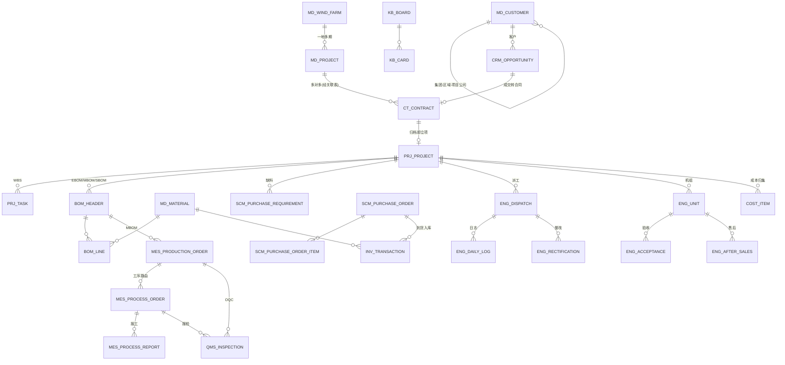

# 02 · 领域模型与数据字典（唯一事实源）

> **本册是数据模型的唯一事实源。** 开发时 DDL 必须由本册逐表生成。字段名、类型、枚举 code、编码格式、软删除与审计字段一律不得更改；与模块册冲突时以本册为准。
> 目标数据库：**GreatDB（MySQL 8.0 语法兼容）**，字符集 `utf8mb4`，排序 `utf8mb4_unicode_ci`。

---

## 一、设计规范（12 条，写进 DDL 注释）

| # | 规范 | 说明 |
|---|---|---|
| 1 | 主键 | `id BIGINT UNSIGNED AUTO_INCREMENT PRIMARY KEY`；业务编码独立字段，**不把编码当主键** |
| 2 | 软删除 | `deleted TINYINT NOT NULL DEFAULT 0`（1=已删）；**所有业务表必须有**；日志与流水表不软删 |
| 3 | 审计字段 | `created_by VARCHAR(64)`、`created_at DATETIME DEFAULT CURRENT_TIMESTAMP`、`updated_by VARCHAR(64)`、`updated_at DATETIME DEFAULT CURRENT_TIMESTAMP ON UPDATE CURRENT_TIMESTAMP` |
| 4 | 多法人 | 涉及合同/库存/成本/报表的表必须有 `legal_entity_id BIGINT`（PRT/TLD） |
| 5 | 项目锚点 | 业务单据必须有 `project_id`；纯备件可空但需 `no_project_reason` 说明 |
| 6 | 金额 | `DECIMAL(18,2)`，单位**元**；禁止 FLOAT/DOUBLE；计算在 Service 用 `BigDecimal` |
| 7 | 数量 | `DECIMAL(14,3)` |
| 8 | 比例/税率 | `DECIMAL(6,4)`（0.1300 = 13%） |
| 9 | 枚举 | `VARCHAR(24)` 存英文大写 code；中文 label 在 `sys_dict_item`；**禁止存中文到枚举字段** |
| 10 | JSON | `JSON` 类型，仅存结构不定的扩展数据；**需要检索/统计的字段必须拆列**；JSON 不建索引 |
| 11 | 乐观锁 | 单据主表带 `version INT NOT NULL DEFAULT 0`，更新时 `WHERE version=?`，影响行数 0 则抛 409 |
| 12 | 编码不可变 | 项目号、合同号、档号、物料编码一经写入即只读（Service 层拦截 + DB 触发器双保险） |

**通用字段缩写**（下文不再重复）：
`[A]` = id, deleted, created_by, created_at, updated_by, updated_at
`[AV]` = [A] + version

---

## 二、实体关系总览



---

## 三、表清单（20 个数据域，按 `T-XXX` 前缀分组，共 **150** 张）

> 注意区分：本册的「数据域」按表前缀划分（20 个）；01 册的「业务域」按功能划分（D00—D17，18 个）。两者不是一一对应，例如 D01 营销与合同对应 T-CRM + T-CT 两个数据域。

| 域 | 表数 | 表名 | 说明 |
|---|---|---|---|
| **T-SYS** 平台底座 | 14 | sys_department, sys_user, sys_role, sys_user_role, sys_permission, sys_role_permission, sys_dict_type, sys_dict_item, sys_operation_log, sys_code_sequence, sys_attachment, sys_import_batch, sys_notification, sys_config | 组织/权限/字典/日志/编码/文件/通知 |
| **T-MDM** 主数据 | 12 | md_legal_entity, md_customer, md_customer_alias, md_wind_farm, md_project, md_project_alias, md_project_product, md_project_change, md_material, md_code_map, md_supplier, md_location | 六类主数据唯一入口 |
| **T-CRM** 营销 | 4 | crm_opportunity, crm_opportunity_followup, crm_customer_profile, crm_sales_funnel | 商机/跟进/客户360/漏斗 |
| **T-CT** 合同 | 7 | ct_contract, ct_contract_payment_plan, ct_contract_risk, ct_contract_change, ct_contract_dispatch, ct_invoice, ct_receipt | 合同全生命周期 |
| **T-PRJ** 项目 | 7 | prj_project, prj_member, prj_task, prj_task_dependency, prj_template, prj_template_task, prj_eco | 项目/WBS/模板/变更 |
| **T-PLM** 设计 | 10 | plm_survey, plm_scheme, plm_design_doc, plm_design_review, bom_header, bom_line, bom_change, bom_change_impact, plm_std_part, plm_requirement_trace | 勘测/设计/BOM/变更 |
| **T-PCS** 工艺 | 5 | pcs_process_doc, pcs_route, pcs_route_step, pcs_worktime, pcs_cable_list | 工艺文件/路线/工时 |
| **T-SCM** 供应链 | 9 | scm_supplier_onboarding, scm_supplier_qualification, scm_supplier_evaluation, scm_price_history, scm_purchase_requirement, scm_purchase_order, scm_purchase_order_item, scm_purchase_return, scm_logistics | 准入/评价/采购/物流 |
| **T-INV** 库存 | 11 | inv_transaction, inv_stock_cache, inv_batch, inv_count, inv_count_line, inv_diff, inv_slow_moving, inv_disposal, inv_replenish, inv_replenish_line, inv_reconcile | 事务/缓存/盘点/呆滞/补货 |
| **T-MES** 生产 | 8 | mes_production_order, mes_process_order, mes_process_report, mes_process_param, mes_andon, mes_material_issue, mes_material_check, mes_work_center | 订单/工序/报工/Andon |
| **T-APS** 排程 | 4 | aps_schedule, aps_schedule_detail, aps_material_check, aps_capacity | 排产/齐套/产能 |
| **T-QMS** 质量 | 9 | qms_inspection_standard, qms_inspection, qms_inspection_item, qms_spc_data, qms_fmea, qms_8d, qms_mrb, qms_gauge, qms_calibration | 检验/SPC/FMEA/8D/量具 |
| **T-EAM** 设备 | 5 | eam_asset, eam_maintenance_plan, eam_maintenance_order, eam_spare_part, eam_failure | 台账/维护/备件/故障 |
| **T-ENG** 工程 | 16 | eng_crew, eng_worker, eng_project_ext, eng_install_plan, eng_unit, eng_acceptance, eng_daily_log, eng_quality_check, eng_rectification, eng_progress, eng_cost_budget, eng_cost_actual, eng_safety_check, eng_material_issue, eng_dispatch, eng_after_sales | 施工/安装/整改/进度/安全/售后 |
| **T-THD** 第三方 | 5 | thd_supplier_account, thd_worker_project, thd_evaluation, thd_blacklist, thd_delivery_note | 门户/授权/评价/黑名单 |
| **T-COST** 成本 | 5 | cost_item, cost_budget, cost_labor_rate, cost_snapshot, cost_evm | 归集/预算/费率/EVM |
| **T-KB** 看板 | 7 | kb_board, kb_metric_def, kb_metric_snapshot, kb_card, kb_card_log, kb_escalation, kb_meeting | 九板/指标/卡片/会议 |
| **T-ARC** 档案 | 4 | arc_archive, arc_borrow, arc_destroy, arc_transfer | 档号/借阅/销毁/移交 |
| **T-AI** AI | 3 | ai_call_log, ai_model_config, ai_feedback | 调用/配置/复核反馈 |
| **T-INT** 集成 | 5 | int_adapter, int_sync_log, int_mapping, int_outbox, int_reconcile_diff | 适配器/日志/映射/队列/对账 |

---

## 四、核心表字段字典（18 张全字段，其余见 §4.20）

### 4.1 T-SYS-02 sys_user 用户

| 字段 | 类型 | 必填 | 约束 | 说明 |
|---|---|---|---|---|
| user_code | VARCHAR(32) | 是 | UNIQUE | 工号 |
| username | VARCHAR(64) | 是 | UNIQUE | 登录名（手机号/工号） |
| real_name | VARCHAR(50) | 是 | | 真实姓名（水印用） |
| password_hash | VARCHAR(100) | 是 | | BCrypt（强度 10） |
| phone | VARCHAR(20) | 否 | | 水印用；脱敏展示 |
| dept_id | BIGINT | 是 | FK sys_department | |
| position | VARCHAR(50) | 否 | | 岗位 |
| user_type | VARCHAR(16) | 是 | E-01 | INTERNAL/SUPPLIER/WORKER |
| legal_entity_id | BIGINT | 是 | FK | 所属法人 |
| status | VARCHAR(16) | 是 | E-02 | ACTIVE/FROZEN/PENDING |
| must_change_pwd | TINYINT | 是 | default 1 | 首登强制改密 |
| pwd_updated_at | DATETIME | 否 | | 密码有效期判定 |
| last_login_at / last_login_ip | DATETIME / VARCHAR(64) | 否 | | |
| valid_from / valid_to | DATE | 否 | | 第三方账号有效期 |
| wx_openid | VARCHAR(64) | 否 | | 小程序绑定 |
| theme_code | VARCHAR(24) | 否 | 字典 THEME | 个人主题偏好（12 套预设，见 03 册 §6A）；空=跟随系统默认 |
| remark | VARCHAR(300) | 否 | | |

**[A]**。索引：`idx_user_dept(dept_id)`、`idx_user_type_status(user_type,status)`。

### 4.2 T-MDM-02 md_customer 客户主体（三级树）

| 字段 | 类型 | 必填 | 约束 | 说明 |
|---|---|---|---|---|
| customer_code | VARCHAR(12) | 是 | UNIQUE | `C{4位}`，不可改 |
| customer_name | VARCHAR(200) | 是 | | 规范全称，与营业执照一致 |
| short_name | VARCHAR(60) | 否 | | |
| parent_id | BIGINT | 否 | FK self | 上级（区域/项目公司→集团） |
| level | VARCHAR(16) | 是 | E-03 | GROUP/REGION/PROJECT |
| customer_type | VARCHAR(16) | 是 | E-04 | OWNER/OEM/RELATED/OTHER |
| group_name | VARCHAR(100) | 否 | | 集团归并名（142→14 用） |
| credit_code | VARCHAR(32) | 否 | | 统一社会信用代码 |
| contact_person / contact_phone | VARCHAR(50) / VARCHAR(30) | 否 | | 脱敏展示 |
| address | VARCHAR(300) | 否 | | |
| level_abc | VARCHAR(4) | 否 | E-05 | A/B/C 客户分级 |
| credit_score / credit_limit | DECIMAL(5,2) / DECIMAL(18,2) | 否 | | 信用 |
| is_internal | TINYINT | 是 | default 0 | 内部关联方（特固兰=1） |
| status | VARCHAR(16) | 是 | E-02 | 停用后不可选 |
| source | VARCHAR(24) | 是 | E-06 | T_PLUS/IMPORT/MANUAL |
| remark | VARCHAR(300) | 否 | | |

**[A]**。索引：`uniq_customer_name(customer_name, deleted)`、`idx_customer_group(group_name)`、`idx_customer_parent(parent_id)`。

> **种子**：`合同与项目信息建档工具表 01 页` 的 142 条（14 集团、39 条"其他/待归类"）直接导入；39 条进"待归类清单"。

### 4.3 T-MDM-05 md_project 项目档案（核心锚点）

| 字段 | 类型 | 必填 | 约束 | 说明 |
|---|---|---|---|---|
| project_code ★ | VARCHAR(16) | 是 | UNIQUE | `PJ{YYYY}-{NNNN}`，永不复用 |
| std_name ★ | VARCHAR(200) | 是 | | 标准名 = 业主规范名－地名（去尾缀）－期次 |
| short_name ★ | VARCHAR(60) | 是 | | 常用简称（现场口语） |
| project_name | VARCHAR(200) | 否 | | 项目业务名（可与合同项目名一致） |
| customer_id ★ | BIGINT | 条件 | FK md_customer | 签约主体（合同甲方） |
| owner_id | BIGINT | 条件 | FK md_customer | 业主（初装可空，`owner_pending=1`） |
| oem_id | BIGINT | 条件 | FK md_customer | 整机厂（纯技改可空） |
| legal_entity_id ★ | BIGINT | 是 | FK md_legal_entity | 我方签约主体 |
| order_type ★ | VARCHAR(16) | 是 | E-07 | 订单类型 |
| farm_id | BIGINT | 条件 | FK md_wind_farm | 排产单可空（`farm_pending=1`） |
| farm_name_raw | VARCHAR(200) | 否 | | 风场全称原文 |
| phase | VARCHAR(20) | 条件 | | 期次 |
| product_lines ★ | JSON | 是 | E-08 数组 | 产品线多选 |
| turbine_model / turbine_qty | VARCHAR(100) / INT | 否 | | 机组 |
| contract_amount | DECIMAL(18,2) | 否 | ≥0 | 合同额（元） |
| set_qty ★ | DECIMAL(14,3) | 是 | >0 | 台数/套数 |
| warranty_start / warranty_end | DATE | 否 | end>start | 质保期 |
| warranty_months | INT | 否 | ≥0 | |
| eng_owner_id ★ | BIGINT | 是 | FK sys_user | 工程责任人 |
| biz_owner_id ★ | BIGINT | 是 | FK sys_user | 商务责任人 |
| svc_owner_id | BIGINT | 条件 | FK sys_user | 售后（质保期内必填） |
| status ★ | VARCHAR(16) | 是 | E-09 | 项目状态 |
| health | VARCHAR(8) | 否 | E-10 | 健康度 G/Y/R |
| owner_pending / farm_pending | TINYINT | 是 | default 0 | 待补全标记 |
| remark | VARCHAR(500) | 否 | | |

**[AV]**。索引：`uniq_project_code(project_code)`、`idx_project_status(legal_entity_id,status)`、`idx_project_farm(farm_id,phase)`、`idx_project_std(std_name)`、FULLTEXT `ft_project_name(std_name, short_name)`。
**核心校验**：同 `farm_id + phase` 下同一产品线只能有一条 ACTIVE 项目；`order_type=OEM_INSTALL` 且 `farm_id` 空时 `farm_pending` 必须为 1。

### 4.4 T-CT-01 ct_contract 合同

| 字段 | 类型 | 必填 | 约束 | 说明 |
|---|---|---|---|---|
| contract_no | VARCHAR(40) | 是 | UNIQUE | 按 §5 规则，不可改 |
| legacy_no | VARCHAR(40) | 否 | | 存量 CON-YYYYMM-nnnn |
| contract_name | VARCHAR(300) | 是 | | 「对方主体－项目/事项」 |
| nature | VARCHAR(8) | 是 | E-11 | XS/CG/KJ |
| party_a / party_b | VARCHAR(200) | 是 | | 甲乙双方（从主体库选） |
| legal_entity_id | BIGINT | 是 | FK | 我方主体 |
| counterparty_id | BIGINT | 否 | FK md_customer | 对方主体编码 |
| business_type | VARCHAR(16) | 是 | E-12 | AZFW/AZFWXF/DJFW/DTAZFW/SB/BJ/JS |
| amount | DECIMAL(18,2) | 是 | ≥0 | 合同金额（元） |
| currency | VARCHAR(8) | 是 | default CNY | |
| tax_rate | DECIMAL(6,4) | 是 | 0—1 | |
| payment_terms | VARCHAR(1000) | 是 | | 付款条件原文 |
| delivery_addr / contact / phone | VARCHAR(300)/VARCHAR(50)/VARCHAR(30) | 否 | | |
| delivery_date | DATE | 否 | | 交货期 |
| warranty_months | INT | 否 | ≥0 | |
| acceptance_clause | VARCHAR(1000) | 否 | | 验收条款 |
| sign_date / effective_date | DATE | 是 | | |
| perform_start / perform_end | DATE | 否 | | |
| copy_count | INT | 否 | ≥1 | 正本份数 |
| handler_id / reviewer_id | BIGINT | 是 | FK sys_user | |
| status | VARCHAR(20) | 是 | E-13 | |
| filed_at | DATETIME | 否 | | 建档完成时间（BR-02 判定） |
| filing_deadline | DATE | 否 | | sign_date + 3 工作日 |
| invoice_frozen | TINYINT | 是 | default 0 | |
| ai_extracted | TINYINT | 是 | default 0 | 是否经 AI 提取 |
| archive_no | VARCHAR(40) | 否 | | 档号 |
| original_file_id | BIGINT | 否 | FK sys_attachment | 签章 PDF |

**[AV]**。索引：`uniq_contract_no`、`idx_contract_status(legal_entity_id,status,sign_date)`、`idx_contract_filing(status,filing_deadline)`。

### 4.5 T-PRJ-01 prj_project 项目

| 字段 | 类型 | 必填 | 说明 |
|---|---|---|---|
| project_no | VARCHAR(32) | 是 | `PRJ-{YYYY}-{4位}`（与 md_project 的 PJ 号区分：md_project 是业务档案，prj_project 是执行实体） |
| md_project_id | BIGINT | 是 | FK md_project（1:1 或 1:N） |
| contract_id | BIGINT | 否 | FK ct_contract |
| project_name | VARCHAR(200) | 是 | |
| manager_id | BIGINT | 是 | 项目经理 |
| template_id | BIGINT | 否 | 项目模板 |
| plan_start / plan_end | DATE | 是 | |
| actual_start / actual_end | DATE | 否 | |
| status | VARCHAR(16) | 是 | E-14 |
| progress_pct | DECIMAL(5,2) | 否 | 0—100 |
| budget_total | DECIMAL(18,2) | 否 | |
| cost_actual | DECIMAL(18,2) | 否 | 冗余汇总 |

**[AV]**。索引：`uniq_prj_no`、`idx_prj_md(md_project_id)`、`idx_prj_manager(manager_id,status)`。

### 4.6 T-PRJ-03 prj_task 任务（WBS）

| 字段 | 类型 | 必填 | 说明 |
|---|---|---|---|
| task_no | VARCHAR(32) | 是 | `T-{project_no}-{3位}` |
| project_id | BIGINT | 是 | |
| parent_id | BIGINT | 否 | 父任务（树形） |
| wbs_code | VARCHAR(40) | 是 | `1.2.3` |
| task_name | VARCHAR(200) | 是 | |
| task_type | VARCHAR(16) | 是 | E-15：NORMAL/APPROVAL/DELIVERABLE |
| dept_id | BIGINT | 是 | 承担部门 |
| assignee_id | BIGINT | 否 | 责任人 |
| role_code | VARCHAR(32) | 否 | 默认角色（自动分配用） |
| is_optional | TINYINT | 是 | 可选任务 |
| plan_start / plan_end | DATE | 是 | |
| actual_start / actual_end | DATETIME | 否 | |
| progress_pct | DECIMAL(5,2) | 否 | |
| status | VARCHAR(16) | 是 | E-16 |
| output_required | TINYINT | 是 | 是否必须上传产出物 |
| output_file_ids | JSON | 否 | 产出物附件 ID |
| approval_required | TINYINT | 是 | |
| approve_by | BIGINT | 否 | |
| delay_days | INT | 否 | 计算得出 |
| pause_reason | VARCHAR(300) | 否 | |

**[AV]**。索引：`idx_task_project(project_id,status)`、`idx_task_assignee(assignee_id,status)`、`idx_task_plan(plan_end)`。

### 4.7 T-PLM-05 bom_header BOM 头（二维矩阵核心）

| 字段 | 类型 | 必填 | 约束 | 说明 |
|---|---|---|---|---|
| bom_no | VARCHAR(48) | 是 | UNIQUE | `BOM-{形态}{视图}-{型号/项目}-V{n}` |
| bom_form | VARCHAR(4) | 是 | E-17 | **A 标准 / B 参数化 / C 工程** |
| bom_view | VARCHAR(8) | 是 | E-18 | **EBOM / MBOM / SBOM** |
| product_line | VARCHAR(16) | 是 | E-08 单值 | |
| product_model | VARCHAR(100) | 是 | | 型号（如 TLDL-300） |
| md_project_id | BIGINT | 条件 | FK | C 类必填 |
| base_bom_id | BIGINT | 否 | FK self | Golden BOM（A/B 类派生源） |
| source_bom_id | BIGINT | 否 | FK self | 视图转换来源（MBOM 来自 EBOM，SBOM 来自 EBOM） |
| version | VARCHAR(16) | 是 | | V1.0 |
| is_current | TINYINT | 是 | | 同 form+view+对象 唯一为 1 |
| status | VARCHAR(16) | 是 | E-19 | |
| mbom_not_applicable | TINYINT | 是 | default 0 | **C 类置 1，明确"不适用"而非遗漏** |
| param_json | JSON | 否 | | B 类参数：塔高/节数/段长/绳长 |
| point_json | JSON | 否 | | C 类点位定义 |
| released_at / released_by | DATETIME / VARCHAR(64) | 否 | | |
| remark | VARCHAR(500) | 否 | | |

**[AV]**。索引：`uniq_bom_no`、`idx_bom_key(bom_form,bom_view,product_line,product_model,is_current)`、`idx_bom_project(md_project_id)`。

> **补充唯一约束**（MySQL 8 不支持部分索引，用生成列实现）：
> ```sql
> ALTER TABLE bom_header ADD COLUMN uniq_key VARCHAR(200)
>   GENERATED ALWAYS AS (CONCAT_WS('|',bom_form,bom_view,product_line,product_model,
>     IFNULL(md_project_id,0),IF(is_current=1,1,id))) STORED;
> ALTER TABLE bom_header ADD UNIQUE KEY uniq_bom_current(uniq_key);
> ```

### 4.8 T-PLM-06 bom_line BOM 行

| 字段 | 类型 | 必填 | 约束 | 说明 |
|---|---|---|---|---|
| bom_header_id | BIGINT | 是 | FK | |
| line_no | VARCHAR(20) | 是 | `^\d+(-\d+){0,2}$` | 层级序号 |
| material_id | BIGINT | **是** | FK md_material | **禁止空、禁止填序号** |
| qty_per_unit | DECIMAL(14,3) | 是 | >0 | |
| unit | VARCHAR(10) | 是 | E-20 | 受控 8 种 |
| loss_rate | DECIMAL(6,4) | 否 | 0—0.5 | |
| material_category | VARCHAR(16) | 否 | E-21 | |
| point_code | VARCHAR(40) | 否 | C 类必填 | 点位（机舱/塔底/塔筒/升压站） |
| process_doc_id | BIGINT | 否 | FK pcs_process_doc | 适用工艺文件 |
| is_project_special | TINYINT | 是 | default 0 | 项目专用件 |
| substitute_material_id | BIGINT | 否 | FK | 替代料 |
| source_type | VARCHAR(16) | 否 | E-22 | 自制/外购/外协/标准件 |
| remark | VARCHAR(300) | 否 | | |

**[A]**。索引：`uniq_bom_line(bom_header_id,line_no,material_id,deleted)`、`idx_bomline_material(material_id)`。

> **齐套算法**：`需求 = qty_per_unit × 台数 × (1+loss_rate)`；`可用 = T+现存量 − 已分配`；`缺料 = max(0, 需求 − 可用)`。

### 4.9 T-INV-01 inv_transaction 库存事务（只增不改不删）

| 字段 | 类型 | 必填 | 约束 | 说明 |
|---|---|---|---|---|
| txn_no | VARCHAR(40) | 是 | UNIQUE | `TX-{YYYYMMDD}-{6位}` |
| txn_type | VARCHAR(20) | 是 | E-23 | RECEIPT/ISSUE/TRANSFER/ADJUST/COUNT_ADJ/RETURN |
| legal_entity_id | BIGINT | 是 | | 两司隔离 |
| warehouse_code / location_id | VARCHAR(20) / BIGINT | 是 | | |
| material_id | BIGINT | 是 | FK | |
| batch_no | VARCHAR(40) | 否 | | 安全件必填 |
| qty | DECIMAL(14,3) | 是 | ≠0 | 正入负出 |
| unit | VARCHAR(10) | 是 | | |
| cost_price | DECIMAL(18,4) | 否 | | 成本单价（R11 脱敏） |
| amount | DECIMAL(18,2) | 否 | | qty × cost_price |
| before_qty / after_qty | DECIMAL(14,3) | 否 | | T+ 回读快照 |
| project_id | BIGINT | 否 | FK | 成本归集维度 |
| source_type / source_id | VARCHAR(24) / BIGINT | 是 | | 来源单据（PO/RECEIPT/SHIP/DISPATCH/REPLENISH/COUNT） |
| source_no | VARCHAR(40) | 否 | | 来源单号（人可读） |
| idempotency_key | VARCHAR(80) | 是 | UNIQUE | `来源单号+行号+动作` |
| sync_status | VARCHAR(16) | 是 | E-24 | PENDING_SYNC/SYNCED/EXCEPTION |
| t_plus_voucher_no | VARCHAR(40) | 否 | | T+ 单据号（同步成功后回写） |
| sync_error | VARCHAR(300) | 否 | | 失败原因 |
| occurred_at | DATETIME | 是 | | **业务发生时间**（≠录入时间） |
| operator_id | BIGINT | 是 | | |
| scanned_code | VARCHAR(100) | 否 | | 扫码原文 |
| remark | VARCHAR(300) | 否 | | |

**[A]（不软删）**。索引：`uniq_idem(idempotency_key)`、`idx_txn_material(material_id,occurred_at)`、`idx_txn_source(source_type,source_id)`、`idx_txn_sync(sync_status)`。

### 4.10 T-MES-02 mes_process_order 工序工单

| 字段 | 类型 | 必填 | 约束 | 说明 |
|---|---|---|---|---|
| process_no | VARCHAR(32) | 是 | UNIQUE | `WS-{生产单号}-{2位}` |
| production_order_id | BIGINT | 是 | FK | |
| process_seq | INT | 是 | | 工序号 |
| process_code / process_name | VARCHAR(32) / VARCHAR(100) | 是 | | |
| process_type | VARCHAR(12) | 是 | E-25 | SERIAL/PARALLEL/CONDITION |
| work_center_id | BIGINT | 是 | FK mes_work_center | |
| standard_hours | DECIMAL(8,2) | 否 | | 标准工时 |
| planned_qty | DECIMAL(14,3) | 是 | >0 | |
| good_qty / defect_qty / scrap_qty | DECIMAL(14,3) | 是 | default 0 | |
| status | VARCHAR(16) | 是 | E-26 | |
| need_inspection | TINYINT | 是 | default 0 | 是否报检 |
| start_time / end_time | DATETIME | 否 | | |
| operator_id | BIGINT | 否 | | |
| locked_reason | VARCHAR(300) | 否 | | 不良锁定原因 |

**[AV]**。索引：`uniq_process_no`、`idx_process_po(production_order_id,process_seq)`、`idx_process_status(status)`。

### 4.11 T-QMS-02 qms_inspection 检验单

| 字段 | 类型 | 必填 | 说明 |
|---|---|---|---|
| inspection_no | VARCHAR(32) | 是 | `QC-{IQC/IPQC/OQC}-{YYYYMMDD}-{3位}` |
| inspection_type | VARCHAR(8) | 是 | E-27：IQC/IPQC/OQC |
| source_type / source_id | VARCHAR(24) / BIGINT | 是 | 来源（采购到货/工序/生产订单/施工） |
| material_id | BIGINT | 否 | |
| batch_no | VARCHAR(40) | 否 | |
| sample_size / defect_count | INT | 是 | |
| aql_level | VARCHAR(10) | 否 | |
| result | VARCHAR(16) | 是 | E-28：PASS/CONCESSION/REJECT/SCREEN |
| inspector_id | BIGINT | 是 | |
| inspection_time | DATETIME | 是 | |
| ai_result_json | JSON | 否 | AI 检测原始返回 |
| ai_confidence | DECIMAL(5,2) | 否 | |
| human_corrected | TINYINT | 是 | 人工是否改判 |
| photo_file_ids | JSON | 否 | |
| remark | VARCHAR(500) | 否 | |

**[AV]**。索引：`idx_qc_source(source_type,source_id)`、`idx_qc_type_time(inspection_type,inspection_time)`。

### 4.12 T-ENG-05 eng_unit 机组（= 设备档案核心）

| 字段 | 类型 | 必填 | 说明 |
|---|---|---|---|
| unit_no | VARCHAR(40) | 是 | `U-{project_code}-{3位}`（机位号） |
| md_project_id | BIGINT | 是 | |
| unit_name | VARCHAR(100) | 否 | 机位名（如 A01） |
| turbine_model / turbine_sn | VARCHAR(100) / VARCHAR(80) | 否 | 机型/机组序列号 |
| product_lines | JSON | 是 | 该机组装了哪些产品 |
| install_date / debug_date / accept_date | DATE | 否 | |
| warranty_start / warranty_end | DATE | 否 | |
| status | VARCHAR(16) | 是 | E-29：待安装→…→过保 |
| sbom_header_id | BIGINT | 否 | FK bom_header（SBOM = 设备档案） |
| location_desc | VARCHAR(200) | 否 | 安装位置描述 |
| qr_code | VARCHAR(64) | 否 | 设备二维码内容 |

**[AV]**。索引：`uniq_unit_no`、`idx_unit_project(md_project_id)`。

### 4.13 T-KB-04 kb_card 看板卡片

| 字段 | 类型 | 必填 | 约束 | 说明 |
|---|---|---|---|---|
| card_no | VARCHAR(24) | 是 | UNIQUE | `C-{板短码}-{5位}` |
| board_id | BIGINT | 是 | FK | |
| title | VARCHAR(200) | 是 | 长度≥8 | 事项，需可交付可验收 |
| title_quality | VARCHAR(16) | 是 | E-30 | OK/VAGUE（命中模糊词） |
| owner_id | BIGINT | 是 | FK sys_user | **唯一责任人** |
| committed_date | DATE | 是 | | 承诺完成日 |
| status | VARCHAR(12) | 是 | E-31 | TODO/DOING/BLOCKED/DONE |
| block_reason | VARCHAR(500) | 条件 | BLOCKED 必填 | 卡点说明 |
| next_action | VARCHAR(300) | 条件 | BLOCKED 必填 | 下一步 |
| target_board_id | BIGINT | 否 | FK | 跨部门挂卡 |
| project_id / contract_id | BIGINT | 否 | FK | 可追溯 |
| blocked_at / escalated_at / closed_at | DATETIME | 否 | | 计时/升级/关闭 |
| is_backfill | TINYINT | 是 | default 0 | 次日补录标记 |
| moved_at | DATETIME | 是 | | 最后移动时间 |

**[AV]**。索引：`idx_card_board(board_id,status)`、`idx_card_esc(status,blocked_at)`、`idx_card_owner(owner_id,committed_date)`。

### 4.14 T-ENG-15 eng_dispatch 派工单

| 字段 | 类型 | 必填 | 说明 |
|---|---|---|---|
| dispatch_no | VARCHAR(32) | 是 | `AS-{YYYYMMDD}-{4位}` |
| md_project_id | BIGINT | 是 | **BR-03** |
| farm_id | BIGINT | 是 | **BR-04 必填** |
| contract_id | BIGINT | 否 | |
| ship_order_id | BIGINT | 否 | 发货触发来源 |
| crew_id | BIGINT | 否 | 施工班组 |
| leader_id / member_ids | BIGINT / JSON | 是 | 主责 + 成员 |
| plan_start / plan_end | DATE | 是 | |
| actual_start / actual_end | DATETIME | 否 | |
| unit_ids | JSON | 否 | 涉及机组 |
| briefing_done | TINYINT | 是 | 方案是否已交底 |
| safety_done | TINYINT | 是 | 安全交底是否完成 |
| status | VARCHAR(16) | 是 | E-32 |
| progress_pct | DECIMAL(5,2) | 否 | |

**[AV]**。索引：`uniq_dispatch_no`、`idx_dispatch_project(md_project_id,status)`、`idx_dispatch_crew(crew_id)`。

### 4.15 T-COST-01 cost_item 成本明细

| 字段 | 类型 | 必填 | 说明 |
|---|---|---|---|
| cost_no | VARCHAR(32) | 是 | `CI-{YYYYMM}-{6位}` |
| project_id | BIGINT | 是 | |
| cost_type | VARCHAR(16) | 是 | E-33：MATERIAL/LABOR/OUTSOURCE/EXPENSE/WARRANTY/SLOWLOSS/OTHER |
| cost_category | VARCHAR(32) | 否 | 二级科目 |
| cost_center | VARCHAR(50) | 否 | |
| amount | DECIMAL(18,2) | 是 | |
| qty / unit_price | DECIMAL(14,3) / DECIMAL(18,4) | 否 | |
| source_type / source_id | VARCHAR(24) / BIGINT | 是 | 来源单据 |
| occurred_date | DATE | 是 | 归属期间 |
| is_backfill | TINYINT | 是 | 补录标记 |
| remark | VARCHAR(300) | 否 | |

**[A]**。索引：`idx_cost_project(project_id,cost_type,occurred_date)`、`idx_cost_source(source_type,source_id)`。

### 4.16 T-SCM-06 scm_purchase_order 采购订单

| 字段 | 类型 | 必填 | 说明 |
|---|---|---|---|
| po_no | VARCHAR(32) | 是 | `PO-{YYYYMM}-{4位}` |
| supplier_id | BIGINT | 是 | |
| legal_entity_id | BIGINT | 是 | |
| project_ids | JSON | 否 | 多项目分摊 |
| total_amount | DECIMAL(18,2) | 是 | **R09/R11/R12 脱敏** |
| tax_rate | DECIMAL(6,4) | 是 | |
| payment_terms | VARCHAR(200) | 否 | |
| expected_date | DATE | 否 | |
| status | VARCHAR(16) | 是 | E-34 |
| dispatched_at | DATETIME | 否 | 下发时间 |
| dispatched_by | BIGINT | 否 | |
| buyer_id | BIGINT | 是 | 采购员 |

**[AV]**。索引：`uniq_po_no`、`idx_po_supplier(supplier_id,status)`、`idx_po_status(status,expected_date)`。

### 4.17 T-SYS-11 sys_code_sequence 编码序列

| 字段 | 类型 | 必填 | 说明 |
|---|---|---|---|
| scope_key | VARCHAR(120) | 是 | UNIQUE，如 `CT:TLD:CG:AZFWXF:2026` |
| period | VARCHAR(16) | 是 | 年度/月/日 |
| current_value | BIGINT | 是 | 当前值 |
| step | INT | 是 | 默认 1 |
| prefix | VARCHAR(40) | 否 | 展示前缀 |
| remark | VARCHAR(200) | 否 | |

**[A]**。**取号必须用 `UPDATE ... SET current_value=current_value+1 WHERE scope_key=?` 后 `SELECT`，或 `LAST_INSERT_ID` 技巧，保证并发唯一；允许空档，不补号。**

### 4.18 T-AI-01 ai_call_log AI 调用日志

| 字段 | 类型 | 必填 | 说明 |
|---|---|---|---|
| call_no | VARCHAR(40) | 是 | `AI-{YYYYMMDD}-{6位}` |
| ai_code | VARCHAR(16) | 是 | AI-001…AI-104 |
| model_type | VARCHAR(8) | 是 | DATA/IMAGE |
| biz_type / biz_id | VARCHAR(32) / BIGINT | 是 | 业务对象 |
| request_json | JSON | 是 | **脱敏后** |
| response_json | JSON | 否 | |
| status | VARCHAR(16) | 是 | SUCCESS/FAILED/TIMEOUT/DEGRADED |
| confidence | DECIMAL(5,2) | 否 | |
| elapsed_ms | INT | 否 | |
| model_version | VARCHAR(40) | 否 | 可复现 |
| prompt_version | VARCHAR(20) | 否 | |
| is_mock | TINYINT | 是 | 是否模拟数据 |
| operator_id | BIGINT | 是 | |

**[A]（不软删）**。索引：`idx_ai_biz(biz_type,biz_id)`、`idx_ai_code_time(ai_code,created_at)`。

### 4.19 T-INT-05 int_reconcile_diff 对账差异

| 字段 | 类型 | 必填 | 说明 |
|---|---|---|---|
| reconcile_date | DATE | 是 | |
| diff_type | VARCHAR(16) | 是 | STOCK/ORDER/TXN |
| legal_entity_id | BIGINT | 是 | |
| material_id / location_id | BIGINT | 否 | 库存差异用 |
| local_value / remote_value | DECIMAL(18,3) | 否 | 本地 vs T+ |
| diff_value | DECIMAL(18,3) | 是 | |
| source_ref | VARCHAR(100) | 否 | 定位信息 |
| status | VARCHAR(16) | 是 | OPEN/CONFIRMED/CLOSED |
| owner_id | BIGINT | 否 | |
| remark | VARCHAR(300) | 否 | |

**[A]**。索引：`idx_rec_date(reconcile_date,diff_type,status)`。

### 4.20 其余表的必备字段（简明）

| 表 | 关键字段 |
|---|---|
| sys_department | dept_code, dept_name, parent_id, dept_type, leader_id, is_chain_master, legal_entity_id, sort_no, status |
| sys_role | role_code, role_name, data_scope(E-35), remark, status |
| sys_user_role | user_id, role_id |
| sys_permission | perm_code(`module:action[:object]`), perm_name, module, perm_type(MENU/BUTTON/API), parent_id |
| sys_role_permission | role_id, perm_id |
| sys_dict_type / sys_dict_item | type_code, type_name / type_id, item_code, item_label, item_value, sort_no, is_default, status |
| sys_operation_log | user_id, user_name, module, action, target_type, target_id, before_json, after_json, ip, trace_id |
| sys_attachment | biz_type, biz_id, file_name, file_path, file_size, file_ext, mime_type, sha256, version, is_watermarked, uploader_id |
| sys_import_batch | batch_no, module, file_name, total_rows, success_rows, fail_rows, status, error_report_path, rolled_back |
| sys_notification | receiver_id, msg_type, title, content, biz_type, biz_id, channel(INNER/WECHAT/BOTH), is_read, read_at |
| sys_config | config_key, config_value, config_group, is_encrypted, remark |
| md_legal_entity | entity_code(PRT/TLD), entity_name, tax_no, address, bank_info, invoice_header |
| md_customer_alias | customer_id, alias_name, alias_type, source |
| md_wind_farm | farm_code(`WF{YYYY}-{NNN}`), farm_name, province, city, county, owner_id, capacity_mw, phase_count, status |
| md_project_alias | md_project_id, alias_name, alias_type(历史写法/口语/错别字), source, created_by |
| md_project_product | md_project_id, product_line, contract_id, set_qty, warranty_start, warranty_end, remark |
| md_project_change | change_no, md_project_id, change_type(FARM_FILL/ENTITY_CHANGE/PHASE_SPLIT), before_json, after_json, approved_by, approved_at |
| md_material | material_code, material_name, spec, unit, category, material_type(STD/SELF/PURCHASE/ELECTRIC/SHEET/VIRTUAL), brand, status, substitute_code, cost_price, safety_stock_min/max, abc_class, is_controlled |
| md_code_map | old_code, new_code, map_type(MERGE/REPLACE/ALIAS), source, remark |
| md_supplier | supplier_code(`S{4位}`), supplier_name, credit_code, level(E-36: STRATEGIC/PREFERRED/QUALIFIED/LIMITED/ELIMINATED), category, contact, phone, payment_terms, status, blacklist_flag |
| md_location | location_code(`{仓库}-{库区}-{排}-{列}-{层}`), warehouse_code, zone_code, row_no, col_no, layer_no, location_type, capacity, abc_class, color_flag(RED/YELLOW/BLUE), qr_code, status |
| crm_opportunity | opp_no(`OPP-{YYYYMM}-{4位}`), opp_name, customer_id, contact, phone, summary, intention_level(H/M/L), expect_sign_date, expect_amount, competitor, owner_id, status(TRACKING/WON/LOST), lost_reason, converted_contract_id |
| crm_opportunity_followup | opportunity_id, follow_type, content, attach_ids, next_action, next_date, operator_id |
| crm_customer_profile | customer_id, total_contract_amount, total_receivable, total_received, complaint_count, satisfaction_score, last_txn_date, rfm_r, rfm_f, rfm_m, profile_json, snapshot_date |
| crm_sales_funnel | opportunity_id, stage, enter_time, exit_time, stay_days, amount, probability |
| ct_contract_payment_plan | contract_id, phase_name, percentage, amount, plan_date, actual_amount, actual_date, status(PENDING/PARTIAL/RECEIVED), invoice_id |
| ct_contract_risk | contract_id, risk_type, risk_level(H/M/L), risk_desc, suggestion, is_adopted, ai_call_id, reviewer_id |
| ct_contract_change | change_no(`{contract_no}-BC{n}`), contract_id, change_type, change_reason, before_json, after_json, amount_delta, approval_status, approved_by, effective_date |
| ct_contract_dispatch | contract_id, receiver_id, dispatch_content, sent_at, read_at, remind_count |
| ct_invoice | invoice_no, contract_id, project_id, invoice_type, amount, tax_rate, tax_amount, invoice_date, status, t_plus_ref, apply_by, confirm_by |
| ct_receipt | receipt_no, contract_id, project_id, payment_plan_id, amount, receipt_date, method, bank_ref, voucher_file_id, status(PENDING/CONFIRMED), confirm_by |
| prj_member | project_id, user_id, role_code, join_date, leave_date, is_active |
| prj_task_dependency | task_id, pre_task_id, dep_type(FS/SS/FF/SF), lag_days |
| prj_template / prj_template_task | template_code, template_name, project_type, is_default, status / template_id, parent_id, task_name, dept_id, role_code, duration_days, is_optional, output_required, approval_required, seq |
| prj_eco | eco_no(`ECN-{YYYY}-{4位}`), project_id, change_reason, change_content, impact_analysis, affected_depts, file_ids, status, approved_by, effective_at, old_disposal_plan |
| plm_survey | project_id, survey_type, survey_date, surveyor_id, content_json, attach_ids, status |
| plm_scheme | project_id, scheme_no, scheme_name, scheme_type, version, review_status, review_opinion, review_meeting_id, attach_ids |
| plm_design_doc | project_id, design_type(ELECTRIC/MECHANICAL), doc_type, doc_name, version, file_id, reviewer_id, review_status, is_locked |
| plm_design_review | design_doc_id, review_type, reviewer_id, result, opinion, reviewed_at, ai_check_result |
| bom_change | change_no(`ECN-{YYYY}-{4位}`), bom_header_id, change_type, change_reason, **old_disposal_plan（BR-09 必填）**, status, approved_by, published_at |
| bom_change_impact | change_id, impact_type(STOCK/WIP/ON_WAY/PROCESS/PROJECT), material_id, qty, amount, action |
| plm_std_part | part_code, part_name, spec, category, prefer_level, usage_count, status |
| plm_requirement_trace | project_id, requirement_desc, source, design_param, verify_method, verify_result, status |
| pcs_process_doc | doc_no(`TLD-GYxxx-nnn`), product_line, doc_type, doc_name, version, is_temp, status(DRAFT/PUBLISHED/PAUSED/ARCHIVED), bom_header_id, file_id, approved_by, published_at |
| pcs_route | bom_header_id, route_no, route_name, version, status |
| pcs_route_step | route_id, step_seq, step_name, work_center_id, standard_hours, is_key, need_inspection, description |
| pcs_worktime | product_model, step_name, standard_hours, labor_rate_id, effective_date |
| pcs_cable_list | project_id, cable_no, from_point, to_point, model, length, remark |
| scm_supplier_onboarding | supplier_name, current_stage(REGISTERED/QUALIFIED/VISITED/SAMPLED/APPROVED/REJECTED), stage_status, qualification_json, audit_result, final_level, apply_by |
| scm_supplier_qualification | supplier_id, cert_type, cert_no, cert_name, issue_date, expire_date, file_id, status |
| scm_supplier_evaluation | supplier_id, eval_period, quality_score, delivery_score, service_score, total_score, grade, evaluator_id |
| scm_price_history | material_id, supplier_id, unit_price, tax_rate, price_date, source_po_id, is_lowest |
| scm_purchase_requirement | req_no(`PR-{YYYYMM}-{4位}`), source_type(BOM_SHORTAGE/SAFETY_STOCK/MANUAL/STOCK), project_id, material_id, qty, expect_date, status, merge_po_id, requester_id |
| scm_purchase_order_item | po_id, line_no, material_id, qty, unit_price, amount, received_qty, expected_date, status |
| scm_purchase_return | return_no, po_id, item_id, qty, reason, return_date, status, t_plus_ref |
| scm_logistics | po_id, carrier, tracking_no, status, last_update, timeline_json |
| inv_stock_cache | legal_entity_id, warehouse_code, location_id, material_id, batch_no, qty_on_hand, qty_allocated, qty_available, cached_at, ttl_seconds, source |
| inv_batch | material_id, batch_no, location_id, qty, locked_qty, receipt_date, supplier_id, expire_date, legal_entity_id |
| inv_count | count_no(`CT-{YYYYMMDD}-{3位}`), count_type(A/B/C/FULL), scope_json, status, started_at, finished_at, creator_id, reviewer_id |
| inv_count_line | count_id, location_id, material_id, batch_no, book_qty, actual_qty, diff_qty, diff_amount, cause, remark |
| inv_diff | diff_no(`DF-{YYYYMM}-{4位}`), count_id, material_id, location_id, book_qty, actual_qty, diff_qty, diff_amount, cause(E-37), approval_level, approved_by, approved_at, closed_at, close_days |
| inv_slow_moving | material_id, location_id, qty, amount, age_days, status(CANDIDATE/CONFIRMED/DISPOSING/DISPOSED), responsibility(E-38), source_ecn_id, first_seen_date |
| inv_disposal | disposal_no, slow_moving_id, method(E-39), qty, expect_amount, actual_amount, approval_level, approved_by, disposed_at, remark |
| inv_replenish | replenish_no(`RP-{YYYYMMDD}-{3位}`), project_id, md_project_id, reason(E-40), urgency, applicant_id, amount, approval_path, need_backfill, backfilled_at, status |
| inv_replenish_line | replenish_id, material_id, qty, unit, use_location, remark |
| inv_reconcile | reconcile_date, legal_entity_id, local_txn_count, t_plus_txn_count, diff_count, diff_amount, status |
| mes_production_order | mo_no(`MO-{YYYYMM}-{4位}`), project_id, mo_type(PROTOTYPE/BATCH/TEMP), bom_header_id, plan_qty, finished_qty, plan_start, plan_end, status, priority |
| mes_process_report | process_order_id, report_type(START/FINISH), good_qty, defect_qty, scrap_qty, work_hours, operator_id, report_time, remark |
| mes_process_param | process_order_id, param_name, param_value, standard_min, standard_max, is_qualified, record_time |
| mes_andon | andon_no, production_order_id, process_order_id, alert_type(EQUIPMENT/MATERIAL/QUALITY/SAFETY), alert_level, content, status, response_at, resolve_at, escalate_at, handler_id |
| mes_material_issue | issue_no, production_order_id, material_id, req_qty, issued_qty, return_qty, status, warehouse_id |
| mes_material_check | process_order_id, material_id, scanned_code, expected_material_id, is_match, check_time, operator_id |
| mes_work_center | wc_code, wc_name, wc_type, capacity_per_day, dept_id, status |
| aps_schedule | schedule_no, schedule_version, schedule_type(MASTER/DETAIL), start_date, end_date, status, algorithm(GA/RULE), created_by |
| aps_schedule_detail | schedule_id, production_order_id, process_order_id, resource_id, planned_start, planned_end, setup_minutes, run_minutes, status |
| aps_material_check | schedule_id, production_order_id, material_id, required_qty, available_qty, shortage_qty, earliest_available_date, is_ready |
| aps_capacity | resource_id, resource_type(EQUIPMENT/PERSON/MOLD), capacity_per_day, calendar_json, status |
| qms_inspection_standard | material_category, inspection_type, aql_level, sample_plan_json, items_json, version, status |
| qms_inspection_item | inspection_id, item_name, standard_value, actual_value, is_qualified, defect_desc |
| qms_spc_data | characteristic, sample_time, subgroup_no, value_x, x_bar, r_value, usl, lsl, cl, ucl, lcl, is_out_of_control |
| qms_fmea | product_id, process_name, failure_mode, failure_effect, severity, failure_cause, occurrence, current_control, detection, rpn, recommended_action, embedding(VECTOR 预留 TEXT) |
| qms_8d | report_no, problem_desc, d1_team, d2_problem, d3_containment, d4_root_cause, d5_corrective, d6_verify, d7_preventive, d8_congratulate, status, owner_id, closed_at |
| qms_mrb | inspection_id, disposition(RETURN/CONCESSION/REWORK/SCRAP), review_opinion, reviewer_ids, status, cost_impact |
| qms_gauge | gauge_code, gauge_name, model, precision, calibrate_cycle_days, last_calibrate_date, next_calibrate_date, location, status |
| qms_calibration | gauge_id, calibrate_date, result, certificate_no, agency, next_date, file_id |
| eam_asset | asset_code, asset_name, asset_type, model, serial_no, manufacturer, purchase_date, warranty_expire, location, status, dept_id, keeper_id |
| eam_maintenance_plan | asset_id, plan_type(DAILY/WEEKLY/MONTHLY/QUARTERLY/YEARLY), content, next_date, cycle_days, responsible_id, status |
| eam_maintenance_order | order_no, asset_id, order_type(PREVENTIVE/REPAIR/INSPECTION), content, planned_date, actual_date, labor_hours, cost, spare_parts_json, status, technician_id |
| eam_spare_part | asset_id, material_id, qty, safety_stock, location_id |
| eam_failure | asset_id, failure_time, repair_time, fault_desc, cause, downtime_minutes, repair_cost |
| eng_crew | crew_code, crew_name, supplier_id, leader_name, leader_phone, qualification_level, score, status, blacklist_flag |
| eng_worker | worker_code, crew_id, name, id_card(加密), phone, certificates_json, insurance_expire, training_records_json, status |
| eng_project_ext | project_id, plan_start, plan_end, actual_start, actual_end, manager_id, status, health, progress_pct |
| eng_install_plan | project_id, unit_id, plan_date, actual_date, responsible_id, content, status |
| eng_acceptance | accept_no, unit_id, project_id, accept_type(FIRST/PARTIAL/FINAL), result, accept_date, sign_file_id, opinion, acceptor_id |
| eng_daily_log | dispatch_id, project_id, worker_id, log_date, weather, content, photo_ids, ai_check_result, status |
| eng_quality_check | unit_id, dispatch_id, check_type, check_item, result, defect_desc, ai_result_json, checker_id, check_time |
| eng_rectification | rect_no, source_type(AI/MANUAL/SUPERVISOR), source_id, project_id, unit_id, problem_desc, photo_ids, requirement, deadline, after_photo_ids, status, confirm_by, closed_at |
| eng_progress | project_id, wbs_code, milestone_name, plan_pct, actual_pct, plan_start, plan_end, status |
| eng_cost_budget | project_id, cost_category, budget_amount, target_amount, version, status |
| eng_cost_actual | project_id, cost_category, amount, voucher_no, occurred_date |
| eng_safety_check | project_id, check_type, check_date, hazard_desc, photo_ids, rect_status, checker_id |
| eng_material_issue | project_id, dispatch_id, material_id, issue_qty, return_qty, status |
| eng_after_sales | order_no(`WO-{YYYYMMDD}-{3位}`), md_project_id, unit_id, fault_type, urgency, warranty_flag, reported_at, responded_at, closed_at, cost_amount, handler_id, status, solution, customer_confirm |
| thd_supplier_account | supplier_id, user_id, account_type(BUSINESS/FINANCE), status |
| thd_worker_project | worker_id, md_project_id, auth_start, auth_end, status, frozen_reason |
| thd_evaluation | target_type(SUPPLIER/CREW), target_id, period, quality_score, delivery_score, safety_score, service_score, total_score, grade |
| thd_blacklist | target_type, target_id, reason, evidence, approved_by, effective_date, release_date, status |
| thd_delivery_note | po_id, note_no, delivery_date, items_json, printed_at, printed_by |
| cost_budget | project_id, version, cost_category, budget_amount, target_amount, status, approved_by |
| cost_labor_rate | role_code / work_center_id, hourly_rate, effective_from, effective_to |
| cost_snapshot | project_id, snapshot_date, material_cost, labor_cost, outsource_cost, expense_cost, warranty_cost, slowloss_cost, other_cost, total_cost, contract_amount, invoiced_amount, received_amount, gross_margin_contract, gross_margin_stage, gross_margin_cash |
| cost_evm | project_id, snapshot_date, pv, ev, ac, spi, cpi |
| kb_board | board_code, board_name, board_level(TOTAL/CHAIN/FUNC), dept_id, chain_master_id, rhythm(DAILY/WEEKLY), sort_no, status |
| kb_metric_def | metric_code, board_id, metric_name, formula_desc, sql_text, unit, target_value, threshold_json, direction(UP/DOWN), refresh_cron, is_manual, owner_id |
| kb_metric_snapshot | metric_id, snapshot_date, actual_value, target_value, status(GREEN/YELLOW/RED), ratio, extra_json |
| kb_card_log | card_id, from_status, to_status, action, remark, operator_id, is_backfill |
| kb_escalation | card_id, level(DAY3/CROSS24/RESP48), escalated_at, notified_ids, handled_at, handled_by |
| kb_meeting | board_id, meeting_date, duration_minutes, attendee_ids, red_count, reviewed_count, closed_count, minutes_json, commitments_json |
| arc_archive | archive_no(`PRT-{YYYY}-{门类}-{期限}-{4位}`), category(E-41), title, retention(E-42), year, box_no, location, dept_id, handler_id, handover_date, contract_id, project_id, status |
| arc_borrow | borrow_no, archive_id, borrower_id, purpose, approver_id, borrow_date, due_date, return_date, status |
| arc_destroy | destroy_no, archive_ids, reason, appraisal_opinion, signers_json, approved_by, destroyed_at, supervisor_ids |
| arc_transfer | transfer_no, from_dept, to_dept, archive_ids, transfer_date, transferor, receiver, supervisor, status |
| ai_model_config | model_type(DATA/IMAGE), model_name, endpoint_url, api_key(加密), timeout_ms, retry, is_mock, health_status, last_check_at |
| ai_feedback | call_id, biz_type, biz_id, ai_field, ai_value, human_value, is_correct, feedback_note, operator_id |
| int_adapter | adapter_code(DINGTALK/T_PLUS/WECHAT/EXPRESS/ONLYOFFICE), mode(API/FILE/MOCK), config_json, enabled, last_ok_at |
| int_sync_log | adapter_code, direction(PULL/PUSH), biz_type, biz_id, request_json, response_json, status, retry_count, error_msg |
| int_mapping | adapter_code, local_table, local_field, remote_field, transform_rule |
| int_outbox | adapter_code, payload_json, status(PENDING/SENT/FAILED), retry_count, next_retry_at, last_error |

---

## 五、编码规则（18 类，唯一事实源）

| # | 编码 | 格式 | 示例 | 生成时机 | 作用域 | 可改 |
|---|---|---|---|---|---|---|
| 1 | 合同号 | `{主体码}-{YYYY}-{性质码}-{业务码}-{4位}` | `TLD-2026-CG-AZFWXF-0091` | 用印登记 | 年×性质×业务码 | 否 |
| 2 | 补充协议 | `{合同号}-BC{n}` | `…-0091-BC1` | 变更提交 | 单合同内 | 否 |
| 3 | 存量合同号 | `CON-{YYYYMM}-{4位}` | `CON-202601-0001` | 历史数据 | — | 否（只读 legacy_no） |
| 4 | 项目档案号 | `PJ{YYYY}-{4位}` | `PJ2026-0138` | 建档 | 全局按年 | 否 |
| 5 | 项目执行号 | `PRJ-{YYYY}-{4位}` | `PRJ-2026-0021` | 立项 | 全局按年 | 否 |
| 6 | 风场号 | `WF{YYYY}-{3位}` | `WF2026-021` | 建档 | 全局按年 | 否 |
| 7 | 客户主体 | `C{4位}` | `C0001` | 建档 | 全局连续 | 否 |
| 8 | 供应商 | `S{4位}` | `S0121` | 建档 | 全局连续 | 否 |
| 9 | 物料 | 沿用现有 8 位数字主干；字母前缀冻结新增 | `30840736` | 申请 | 大类-品类-规格 | 否 |
| 10 | 虚拟件 | `V-{8位}` | `V-00001234` | 补码 | 全局连续 | 否 |
| 11 | 货位 | `{仓库码}-{库区码}-{排}-{列}-{层}` | `YL-QT-03-05-2` | 建档 | 仓库内 | 否 |
| 12 | 档号 | `{主体码}-{YYYY}-{门类}-{期限}-{4位}` | `PRT-2026-HT-Y-0007` | 档案移交 | 年×门类×期限 | 否 |
| 13 | 商机号 | `OPP-{YYYYMM}-{4位}` | `OPP-202610-0031` | 商机创建 | 月 | 否 |
| 14 | 采购需求 | `PR-{YYYYMM}-{4位}` | `PR-202610-0012` | 需求创建 | 月 | 否 |
| 15 | 采购订单 | `PO-{YYYYMM}-{4位}` | `PO-202610-0008` | 订单创建 | 月 | 否 |
| 16 | 生产订单 / 工序 | `MO-{YYYYMM}-{4位}` / `WS-{MO后6位}-{2位}` | `MO-202610-0003` / `WS-100003-01` | 创建 | 月 / 单内 | 否 |
| 17 | 派工 / 售后 / 发货 | `AS-{YYYYMMDD}-{4位}` / `WO-{YYYYMMDD}-{3位}` / `SH-{YYYYMMDD}-{3位}` | `AS-20261029-0012` | 创建 | 日 | 否 |
| 18 | ECN / 盘点 / 差异 / 处置 / 补货 | `ECN-{YYYY}-{4位}` / `CT-{YYYYMMDD}-{3位}` / `DF-{YYYYMM}-{4位}` / `DP-{YYYYMM}-{4位}` / `RP-{YYYYMMDD}-{3位}` | `ECN-2026-0031` | 提交 | 年/月/日 | 否 |

**通用规则**：
- 编码一律大写、无空格、无中文；流水统一 4 位（除注明 3 位）。
- **不可修改、不可复用、允许空档**（事务回滚产生的跳号不补）。
- 存量编码不改，登记 `md_code_map`。
- 取号必须走 `sys_code_sequence`，禁止在代码里拼字符串。

---

## 六、枚举字典（E-01 ~ E-42）

| 编号 | 枚举 | 取值（code:label） |
|---|---|---|
| E-01 | user_type | INTERNAL:内部员工 / SUPPLIER:供应商人员 / WORKER:施工人员 |
| E-02 | common_status | ACTIVE:启用 / FROZEN:停用 / PENDING:待激活 |
| E-03 | customer_level | GROUP:集团本部 / REGION:区域省级 / PROJECT:项目公司 |
| E-04 | customer_type | OWNER:业主 / OEM:整机厂 / RELATED:关联方 / OTHER:其他 |
| E-05 | level_abc | A:A 类 / B:B 类 / C:C 类 |
| E-06 | data_source | T_PLUS:T+导入 / IMPORT:批量导入 / MANUAL:手工录入 / API:接口 |
| E-07 | order_type | OWNER_RETROFIT:业主技改 / OEM_INSTALL:整机厂初装 / SPARE:备件 / MAINTENANCE:定检服务 |
| E-08 | product_line | LADDER:升降机 / CLIMBER:免爬器 / CLIMB:爬梯 / RAIL:导轨 / CCTV:视频监控 / FIRE:自动消防 / COVER:自动盖板 / ROPE:钢丝绳 / AUDIO:声频 / SENSOR:感温磁 / OTHER:其他 |
| E-09 | project_status | SIGNED_PENDING:签约待执行 / EXECUTING:执行中 / SHIPPED:已发货 / ACCEPTED:已验收 / WARRANTY:质保期中 / CLOSED:已关闭 |
| E-10 | health | GREEN:绿 / YELLOW:黄 / RED:红 |
| E-11 | contract_nature | XS:销售合同 / CG:采购外包合同 / KJ:框架协议 |
| E-12 | business_type | AZFW:安装服务 / AZFWXF:消防安装服务 / DJFW:定检服务 / DTAZFW:升降机安装服务 / SB:设备供货 / BJ:备件 / JS:技术服务 |
| E-13 | contract_status | DRAFT:编辑中 / REVIEWED:已评审 / SIGNED:已签署 / PERFORMING:履行中 / ACCEPTED:已验收 / WARRANTY:质保期中 / CLOSED:已关闭 / CHANGED:已变更 / PAUSED:已暂停 |
| E-14 | prj_status | NOT_STARTED:未启动 / IN_PROGRESS:进行中 / COMPLETED:已完成 / CLOSED:已关闭 / PAUSED:已暂停 / CANCELLED:已取消 |
| E-15 | task_type | NORMAL:普通 / APPROVAL:审批 / DELIVERABLE:交付物 |
| E-16 | task_status | TODO:未开始 / DOING:进行中 / DONE:已完成 / DELAYED:已延期 / PAUSED:暂停 / CANCELLED:取消 / PENDING_APPROVAL:待审批 |
| E-17 | bom_form | A:标准产品 / B:参数化定制 / C:系统工程 |
| E-18 | bom_view | EBOM:设计 / MBOM:制造 / SBOM:服务 |
| E-19 | bom_status | DRAFT:草稿 / REVIEW:审核中 / RELEASED:已发布 / OBSOLETE:已作废 |
| E-20 | uom | PCS:个 / SET:套 / UNIT:台 / M:米 / KG:千克 / PKG:包 / PAIR:对 / BOX:盒（**仅 8 种**） |
| E-21 | material_category | STD:标准件 / SELF:自制件 / PURCHASE:外购件 / ELECTRIC:电气件 / SHEET:钣金件 |
| E-22 | source_type | SELF:自制 / PURCHASE:外购 / OUTSOURCE:外协 / STD:标准件 |
| E-23 | txn_type | RECEIPT:入库 / ISSUE:出库 / TRANSFER:移库 / ADJUST:调整 / COUNT_ADJ:盘盈亏调整 / RETURN:退料 |
| E-24 | sync_status | PENDING_SYNC:待同步 / SYNCED:已同步 / EXCEPTION:异常挂起 |
| E-25 | process_type | SERIAL:串行 / PARALLEL:并行 / CONDITION:条件分支 |
| E-26 | process_status | TODO:待开工 / DOING:生产中 / WAIT_QC:待检 / DONE:已完成 / LOCKED:已锁定 |
| E-27 | inspection_type | IQC:来料 / IPQC:过程 / OQC:成品 |
| E-28 | inspection_result | PASS:合格 / CONCESSION:让步接收 / REJECT:退货 / SCREEN:筛选 |
| E-29 | unit_status | TO_INSTALL:待安装 / INSTALLING:安装中 / TO_DEBUG:待调试 / DEBUGGING:调试中 / TO_ACCEPT:待验收 / ACCEPTING:验收中 / ACCEPTED:已验收 / WARRANTY:质保中 / EXPIRED:过保 |
| E-30 | title_quality | OK:合格 / VAGUE:表述模糊 |
| E-31 | card_status | TODO:未开始 / DOING:进行中 / BLOCKED:受阻 / DONE:已完成 |
| E-32 | dispatch_status | TO_DISPATCH:待派 / DISPATCHED:已派 / DOING:进行中 / TO_ACCEPT:待验收 / DONE:已完成 / CLOSED:已关闭 |
| E-33 | cost_type | MATERIAL:材料 / LABOR:人工 / OUTSOURCE:外协 / EXPENSE:费用 / WARRANTY:质保 / SLOWLOSS:呆滞损失 / OTHER:其他 |
| E-34 | po_status | DRAFT:编辑中 / DISPATCHED:已下发 / PARTIAL:部分到货 / RECEIVED:全部到货 / CLOSED:已关闭 / PARTIAL_RETURN:部分退货 / ALL_RETURN:全部退货 |
| E-35 | data_scope | SELF:本人 / DEPT:本部门 / DEPT_SUB:本部门及下级 / PROJECT:项目成员 / ALL:全局 |
| E-36 | supplier_level | STRATEGIC:战略 / PREFERRED:优选 / QUALIFIED:合格 / LIMITED:限制 / ELIMINATED:淘汰 |
| E-37 | diff_cause | DOC_LAG:单据滞后 / REPLENISH_UNBOOKED:补发货未记账 / MIX_ENTITY:两司串料 / PICK_ERROR:领退料错账 / LOST:丢失 / MEASURE:计量误差 |
| E-38 | slow_responsibility | DESIGN:设计变更 / PURCHASE_OVER:采购过量 / PRODUCTION_LEFT:生产剩余 / ORDER_CANCEL:客户取消 / QUALITY:质量退回 / HISTORY:历史遗留 |
| E-39 | disposal_method | REUSE:优先领用 / SERVICE:工程售后利用 / REMODEL:改制利用 / SELL:折价出售 / SCRAP:报废 / CUSTOMER:客户消化 |
| E-40 | replenish_reason | DAMAGE:正常损坏 / SHORT:数量不足 / QUALITY:零件质量 / PREPICK:维修预领 / ADDITION:设计追加 / LOST_SITE:现场丢失 / CUSTOMER_LOST:客户损坏 / OTHER:其他 |
| E-41 | arc_category | XZ:行政 / ZZ:证照 / HT:合同 / CW:财务 / RS:人事 / GC:工程 / JY:业务 / SX:声像 |
| E-42 | retention | Y:永久 / S30:30年 / S10:10年 |

---

## 七、状态机（迁移条件）

> 通用：只能按箭头前进；回退必须由"驳回/撤销"动作触发并留痕；已关闭不可再改，只能新建变更单。

### 7.1 合同（E-13）

| 当前 | 触发 | 目标 | 条件 |
|---|---|---|---|
| DRAFT | 提交评审 | REVIEWED | BR-01 通过（project_id 非空）；六要素+附件核对完成 |
| REVIEWED | 用印登记 | SIGNED | 生成合同号；正本份数≥1 |
| SIGNED | 建档完成 | PERFORMING | 26 要素完整 + filed_at 有值 |
| PERFORMING | 验收通过 | ACCEPTED | 存在 eng_acceptance.result=PASS |
| ACCEPTED | 质保期开始 | WARRANTY | warranty_months>0 |
| WARRANTY | 质保结束 | CLOSED | 质保金已释放或确认 |
| 任意（非 CLOSED） | 变更审批通过 | CHANGED→回原状态 | 生成 `-BCn`；旧版本留存 |
| PERFORMING | 暂停 | PAUSED | 需填原因；恢复回 PERFORMING |

### 7.2 项目（E-14）

| 当前 | 触发 | 目标 | 条件 |
|---|---|---|---|
| NOT_STARTED | 首个任务开工/首个采购下单 | IN_PROGRESS | — |
| IN_PROGRESS | 全部任务完成且全部验收 | COMPLETED | 无未完成 task；无未验收 unit |
| COMPLETED | 结算完成 | CLOSED | 回款率 100% 或已标坏账；质保金已释放 |
| 任意 | 范围变更 | PAUSED | 需 R02 审批 |

### 7.3 BOM（E-19）

| 当前 | 触发 | 目标 | 条件 |
|---|---|---|---|
| DRAFT | 提交审核 | REVIEW | 行数>0；物料全部存在；13 条校验无 ERROR |
| REVIEW | 审核通过 | RELEASED | 审核人≠创建人；`is_current=1` 原子替换旧版本 |
| RELEASED | ECN 发布 | OBSOLETE | 必须有后继版本 |
| REVIEW | 驳回 | DRAFT | 记录驳回理由 |

### 7.4 采购订单（E-34）

| 当前 | 触发 | 目标 | 条件 |
|---|---|---|---|
| DRAFT | 下发 | DISPATCHED | 供应商已准入（APPROVED）且资质未过期 |
| DISPATCHED | 首次到货 | PARTIAL | received_qty>0 且 <qty |
| PARTIAL | 全部到货 | RECEIVED | 所有行 received_qty=qty |
| RECEIVED | 质检合格且入库 | CLOSED | — |
| 任意 | 退货 | PARTIAL_RETURN / ALL_RETURN | 需质检不合格报告 |

### 7.5 工序（E-26）

| 当前 | 触发 | 目标 | 条件 |
|---|---|---|---|
| TODO | 开工 | DOING | 前置工序 DONE；物料防错校验通过 |
| DOING | 完工（需报检） | WAIT_QC | 报工提交；good+defect+scrap=planned |
| DOING | 完工（免检） | DONE | 同上前置 |
| WAIT_QC | 检验合格 | DONE | qms_inspection.result=PASS |
| DOING | 发现不良 | LOCKED | 扫码锁定；触发 MRB |

### 7.6 补货单（含 BR-05）

| 当前 | 触发 | 目标 | 条件 |
|---|---|---|---|
| 待审批 | 分级审批通过 | 已审批 | <500 且标准件→一级；500—5000→两级；>5000 或涉设计变更→三级 |
| 已审批 | 出库 | 已出库 | 安全件可先出库 |
| 已出库 | 补齐手续 | 已补签 | 24h 内；超时锁定新申请 |
| 已补签 | 归档 | 已关闭 | — |

### 7.7 其余实体

| 实体 | 状态链 |
|---|---|
| 商机 | TRACKING → WON / LOST →（重激活）TRACKING |
| 任务 | TODO → DOING → DONE；旁支 DELAYED / PAUSED / CANCELLED / PENDING_APPROVAL |
| ECO | 发起 → 会签中 → 已批准 → 已生效 / 已驳回 |
| 排产 | 计算中 → 已发布 → 已调整 |
| 派工 | TO_DISPATCH → DISPATCHED → DOING → TO_ACCEPT → DONE → CLOSED |
| 售后 | 待派工 → 已派工 → 处理中 → 待验收 → 已关闭（可挂起/转派） |
| 机组 | TO_INSTALL → INSTALLING → TO_DEBUG → DEBUGGING → TO_ACCEPT → ACCEPTING → ACCEPTED → WARRANTY → EXPIRED |
| 整改 | 待整改 → 整改中 → 待复核 → 复核通过 → 关闭（不通过回退） |
| 盘点 | 已创建 → 盘点中 → 待复核 → 差异处理 → 已调账 → 已关闭 |
| 呆滞处置 | CANDIDATE → CONFIRMED → DISPOSING → DISPOSED |
| 红灯卡 | TODO/DOING → BLOCKED → DONE（可 ESCALATED） |

---

## 八、索引、约束与扩展

### 8.1 必备索引

| 表 | 索引 | 目的 |
|---|---|---|
| md_project | `(legal_entity_id,status)`、`(farm_id,phase)`、FULLTEXT(std_name,short_name) | 列表/一风场一档/查重 |
| md_customer | `(group_name)`、`(parent_id)`、UNIQUE(customer_name,deleted) | 归并视图/树 |
| ct_contract | `(legal_entity_id,status,sign_date)`、`(status,filing_deadline)` | 台账/冻结扫描 |
| prj_task | `(project_id,status)`、`(assignee_id,status)`、`(plan_end)` | 甘特/我的任务/逾期扫描 |
| bom_line | `(bom_header_id,line_no)`、`(material_id)` | 展开/反查 |
| inv_transaction | UNIQUE(idempotency_key)、`(material_id,occurred_at)`、`(sync_status)` | 幂等/流水/补偿 |
| mes_process_order | `(production_order_id,process_seq)`、`(status)` | 工序链/待办 |
| eng_unit | `(md_project_id)`、UNIQUE(unit_no) | 机组列表 |
| kb_card | `(board_id,status)`、`(status,blocked_at)` | 四区视图/升级扫描 |
| sys_operation_log | `(user_id,created_at)`、`(target_type,target_id)` | 追溯 |

### 8.2 关键唯一约束

- `md_project.project_code`、`ct_contract.contract_no`、`md_customer.customer_code`、`md_wind_farm.farm_code`、`md_material.material_code`、`inv_transaction.idempotency_key`、`prj_project.project_no`、`kb_card.card_no`。
- `bom_header` 用生成列实现"同形态+视图+对象只能一个现行"（见 §4.7）。
- `inv_stock_cache (legal_entity_id,warehouse_code,location_id,material_id,IFNULL(batch_no,''))`。
- `sys_code_sequence.scope_key`。

### 8.3 扩展机制（应对"业务不能自助改表单"）

| 机制 | 做法 | 限制 |
|---|---|---|
| 扩展字段 | 主数据与单据表预留 `ext_json JSON`；管理界面可配字段名/类型/是否必填/是否列表显示 | 不支持跨表关联，不参与计算；**不得用于核心业务字段** |
| 自定义枚举 | `sys_dict_item` 可增删自定义项 | 系统枚举（E-01~E-42）不可删，只可增 |
| 审批模板 | `sys_config` 存审批链 JSON（节点=角色/用户+条件+时限） | 一期不支持条件分支编排 |
| 指标阈值 | `kb_metric_def.threshold_json` 可改红黄绿阈值 | SQL 公式不可前端改 |
| 工时费率 | `cost_labor_rate` 可按角色/工作中心配置 | 变更只影响后续快照，不回溯 |

### 8.4 数据量与归档

| 表 | 策略 |
|---|---|
| sys_operation_log | 按月分区；2 年热数据，之后转 `sys_operation_log_archive`（只读） |
| inv_transaction | 全量保留（年约 8 万行）；3 年后可按年归档 |
| qms_spc_data | 保留 2 年；日数据按月聚合后删明细 |
| kb_metric_snapshot | 保留 2 年 |
| sys_notification | 已读 90 天后清理 |
| int_sync_log | 保留 6 个月 |
| ai_call_log | 保留 1 年（训练样本另行导出） |

**声明：本方案为产品设计参考，具体实施请结合公司合规与法务要求确认。**
